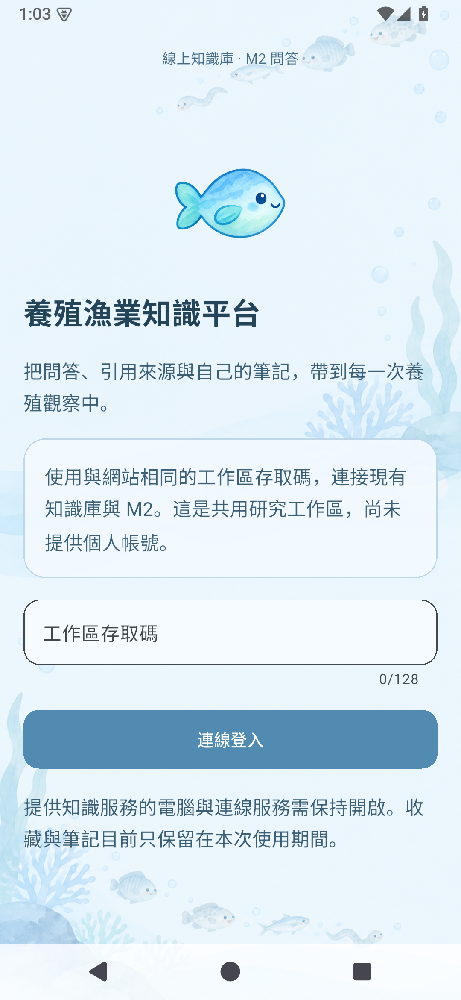
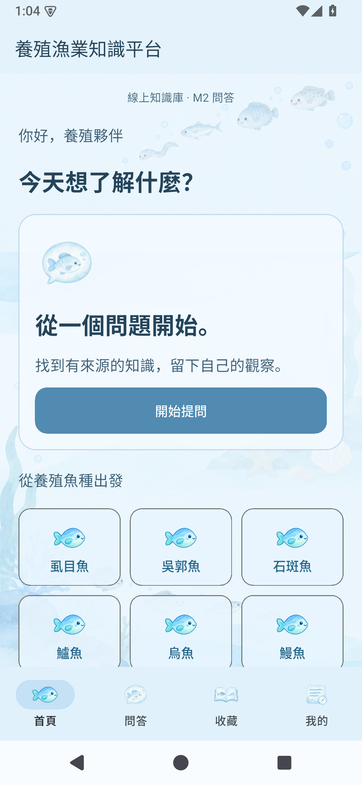

# 養殖漁業知識平台 Flutter App

Android 與 iPhone 共用的 Flutter／Dart 專案，可用 Android Studio 開啟，沿用網站海洋水彩背景與魚圖示。

## 下載 Android 測試 APK

[下載 0.3.2 線上問答 APK](https://github.com/ethanworkspace/aquaculture-knowledge-app/releases/download/v0.3.2-live/aquaculture-knowledge-app-0.3.2-live.apk) · [版本說明與校驗碼](https://github.com/ethanworkspace/aquaculture-knowledge-app/releases/tag/v0.3.2-live)

Android 7.0 以上可安裝。使用**與網站相同的工作區存取碼**登入，即可向現有 v6 知識庫與 M2 提問，查看回答狀態及實際引用來源。本版是共用研究工作區，尚未提供個人帳號。

提供知識服務的電腦、Ollama、API 與 HTTPS 連線服務需保持開啟。App 沿用網站的 GitHub 連線清單取得目前服務位置；位置變更需重新登入。忙碌時不承諾排隊，可稍後接續原請求。

收藏、筆記與手機紀錄只保留在本次使用期間，登出或關閉程式即清除。後端仍依研究系統既有政策保存問答紀錄；手機清除不刪除研究資料。APK 採 Release 編譯與開發用 debug 簽章，已通過 Android 15 模擬器安裝與問答流程檢查，尚未完成實體手機驗收。iPhone 無法安裝 APK，需在 macOS／Xcode 另行簽署。

## 開發與打包

```sh
flutter pub get
dart format lib test
flutter analyze
flutter test
python -m unittest discover -s server -v
flutter build apk --release
```

輸出為 `build/app/outputs/flutter-apk/app-release.apk`。預設連線真實服務；離線示範需明確使用 `--dart-define=DEMO_MODE=true`，畫面會標示示範資料。不要把存取碼或管理金鑰放入程式、建置參數或 repo。

0.3.2 已優化排序分批、預載入與檢索快取。同兩題真實 HTTPS 比較：首次查詢平均 26.5 秒降至 19.7 秒（約快 26%）；命中檢索快取後重問平均 5.3 秒，每次仍由 M2 重新生成。這是小樣本實測，首次新問題與服務重啟仍有準備成本。詳見 [速度報告](docs/PERFORMANCE.md)；前版 [驗收報告](docs/ACCEPTANCE.md) 保留。

Windows 可使用 `scripts/build-apk.ps1`。詳見 [開發指南](docs/DEVELOPMENT.md)、[驗證紀錄](docs/VALIDATION.md) 與 [App API 規格](docs/api/APP_GATEWAY.md)。

## 功能與目錄

| 位置 | 內容 |
|---|---|
| `lib/` | 線上登入、首頁、M2 問答、來源、收藏筆記與本次紀錄 |
| `android/`、`ios/` | Android 與 iPhone 原生工程 |
| `assets/website/` | 網站原始背景與圖示，含來源與 SHA-256 |
| `server/` | 已部署的 App 入口、後端整合差異與測試 |
| `config/` | 連線清單來源說明，無管理金鑰 |
| `test/` | 業務、HTTPS 客戶端、手機畫面與選用真實問答測試 |
| `prototype/v1/` | 原有 HTML 畫面原型與素材 |
| `docs/api/` | 原有 API 盤點與本版入口規格 |
| `archive/expo/` | 先前 Expo 程式的歷史參考 |

`Flutter → HTTPS 工作區連線 → App 專用入口 → 現有 v6 知識庫／M2`。回答只顯示查核後的內容與來源；證據不足及驗證失敗會分別標示。斷線可重用原識別碼接續。

既有 [Hybrid-RAG 專案](https://github.com/ethanworkspace/hybrid-rag-aquaculture-knowledge-platform) 保留知識庫、模型與研究紀錄。本 repo 不包含服務金鑰、資料庫、第三方來源全文、模型或使用者資料。

以下為 0.3.2 APK 安裝後的實際 App 畫面，拍攝於 Android 15 模擬器；目前尚未取得實體手機截圖。

<p>
  
  
</p>

程式沿用 MIT 授權；網站素材來源見 assets/website/README.md 與 manifest.json，不擴及未包含的第三方知識來源或模型。
