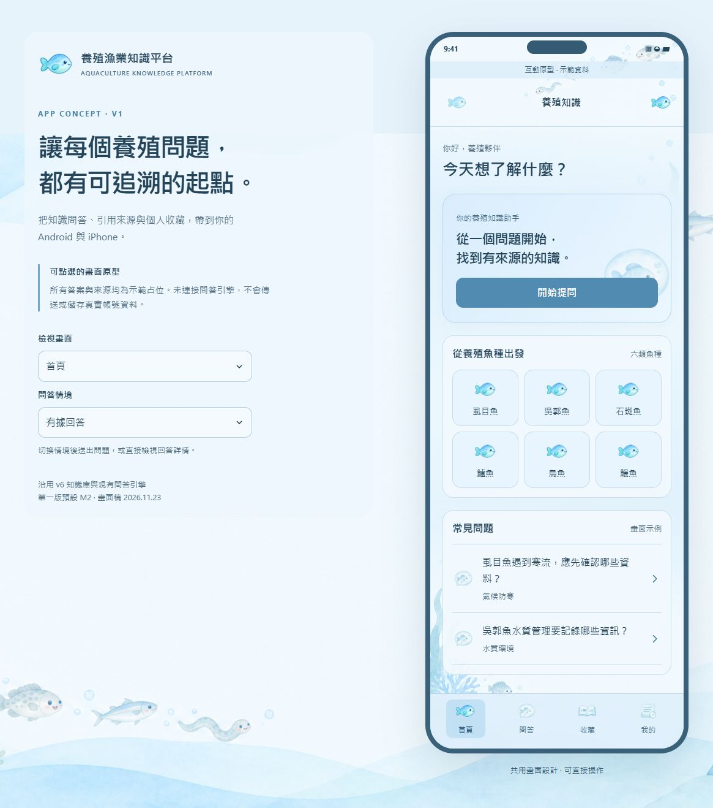

# 養殖漁業知識平台 App

Android／iPhone 共用 App 專案，沿用既有 [Hybrid-RAG 養殖知識平台](https://github.com/ethanworkspace/hybrid-rag-aquaculture-knowledge-platform) 的知識庫、問答引擎與網站原創水彩素材。

目前為 **React Native + Expo SDK 58 + TypeScript 的開發起點**。已建立主要畫面、檔案式導覽與模擬服務；未連接正式 RAG、未實作真實帳號或雲端同步，尚未產生 APK／IPA 或上架。



## 專案內容

| 位置 | 內容 |
|---|---|
| `src/app/` | 登入、首頁、問答、回答、來源、收藏筆記、紀錄與我的 |
| `src/services/mock.ts` | 可切換七種情境的模擬問答；不呼叫模型 |
| `src/domain.ts` | 問題、任務、答案與來源型別及保守的回答呈現規則 |
| `src/store.tsx` | 目前使用期間的示範狀態，含任務、收藏、筆記與登出清除 |
| `assets/website/` | 原樣沿用網站海洋水彩背景與圖示 |
| `prototype/v1/` | 可直接開啟的 HTML 互動原型、素材及設計驗證紀錄 |
| `docs/api/` | 現有 API 盤點與未實作的 App 服務入口契約 |
| `docs/DEVELOPMENT.md` | 開發、實機驗證與後續工作 |
| `tests/` | 輸入限制、回答驗證失敗及未知狀態的保守處理測試 |

## 開始使用

使用 Node.js 24 LTS 與 npm：

```sh
npm ci
npm start
```

開啟 Expo Go 掃描開發服務的 QR code，或連接相容的 Android 模擬器。iPhone 使用實機 Expo Go 或之後的開發版本；Windows 無法本機執行 iOS 模擬器。SDK 相容性依手機上的 Expo Go 版本而定。

```sh
npm run android
npm run web
npm run typecheck
npm run lint
npm test
npm run export:web
```

HTML 畫面原型可直接開啟 `prototype/v1/index.html`，或執行 `npm run preview:prototype` 後瀏覽 `http://127.0.0.1:8877`。若埠號已占用，先停止原服務或改用其他埠號。

## 目前可操作

示範登入 → 選魚種或問題 → 模擬問答 → 回答 → 引用來源 → 收藏 → 編輯獨立個人筆記 → 問答紀錄。從「我的」切換有據回答、部分資訊、證據不足、驗證失敗、離線、忙碌與任務失敗。

資料僅保存在記憶體；重新啟動或登出會清除，不代表正式持久化、後端隔離或離線 AI。畫面來源與答案都是明示的占位資料，不作為養殖建議。

## 正式串接邊界

`App → 使用者登入與服務入口 → 既有私有問答 API → v6 RAG／M2`。

既有 `/v1/jobs`、引用與圖像可重用；服務入口還需提供使用者權限、個人資料、任務所有權、穩定連線及限流。**目前共用 RAG 金鑰不能嵌入 App**。此 repository 不包含原始資料庫、模型、第三方來源全文、憑證與使用者資料。

正式 Android／iOS 專案由 Expo Prebuild 按設定產生，`android/`、`ios/` 不手工建立或提交。應用識別碼目前是開發用設定，正式發佈前需確認；雲端簽署／建置與商店提交尚未設定。

## 參考與授權

- [Expo 專案建立](https://docs.expo.dev/get-started/create-a-project/)
- [Expo Router 安裝](https://docs.expo.dev/router/installation/)
- [Expo 原生專案生成](https://docs.expo.dev/workflow/continuous-native-generation/)
- 程式沿用原專案 MIT 授權；素材來源與雜湊見 [素材說明](assets/website/README.md)。此授權不擴及未包含的第三方知識來源、模型與資料集。
